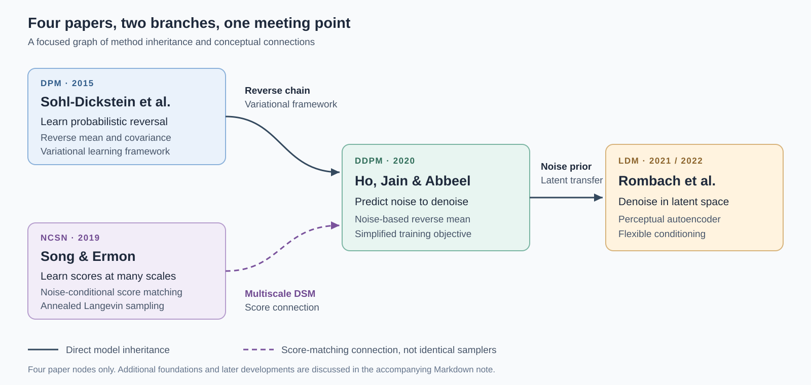
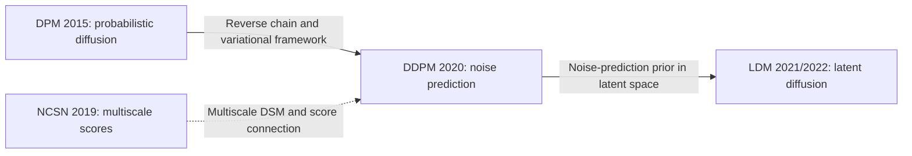

# Four Papers Behind Modern Diffusion Models

**A comparative reading note: contributions, methods, evidence, and intellectual connections**  
Prepared: November 7, 2026. Language: English.

## 1. Scope and central argument

This note reviews the four requested papers, including their main methods, relevant experiments, and supplementary explanations. It separates **reported findings** from **interpretation**. All numerical results below come from the authors; no new model experiment was performed.

| Short name | Paper and authors | Publication context | Version used |
| --- | --- | --- | --- |
| DPM 2015 | *Deep Unsupervised Learning using Nonequilibrium Thermodynamics* — Jascha Sohl-Dickstein, Eric A. Weiss, Niru Maheswaranathan, Surya Ganguli | ICML 2015 | [arXiv v8](https://arxiv.org/pdf/1503.03585v8) |
| NCSN 2019 | *Generative Modeling by Estimating Gradients of the Data Distribution* — Yang Song, Stefano Ermon | NeurIPS 2019 | [arXiv v3](https://arxiv.org/pdf/1907.05600v3) |
| DDPM 2020 | *Denoising Diffusion Probabilistic Models* — Jonathan Ho, Ajay Jain, Pieter Abbeel | NeurIPS 2020 | [arXiv v2](https://arxiv.org/pdf/2006.11239v2) |
| LDM 2022 | *High-Resolution Image Synthesis with Latent Diffusion Models* — Robin Rombach, Andreas Blattmann, Dominik Lorenz, Patrick Esser, Björn Ommer | Preprint in December 2021; CVPR 2022 | [arXiv v2](https://arxiv.org/pdf/2112.10752v2) |

**The historical interpretation developed here:** these papers solve different parts of the same generative problem. Their relationship is better understood as two branches meeting at DDPM, followed by a change of representation in LDM, than as four interchangeable denoising algorithms.

The guiding question is: **How can learning to remove noise enable a model to generate new images?** A useful answer must explain both the distribution learned by denoising and the procedure that turns that knowledge into samples.

## 2. Individual paper reviews

### 2.1. DPM 2015 — establish the probabilistic framework

#### Main contributions

- Define a generative model through a learned reverse Markov chain paired with gradual forward corruption.
- Derive a tractable variational likelihood bound and local training targets.
- Develop Gaussian and binomial diffusion, conditional inference, and reverse-step entropy bounds.

#### Key method

Using a common notation for the Gaussian case:

$$
q(x_t\mid x_{t-1})=
\mathcal N\!\left(\sqrt{1-\beta_t}\,x_{t-1},\beta_t I\right),
$$

$$
p_\theta(x_{t-1}\mid x_t)=
\mathcal N\!\left(\mu_\theta(x_t,t),\Sigma_\theta(x_t,t)\right).
$$

The image network learns reverse means and diagonal covariances, **not an explicit noise predictor**. In its Gaussian experiments, $\beta_1$ is fixed and subsequent variances are learned; fixed schedules are also discussed.

The tractable training posterior is $q(x_{t-1}\mid x_t,x_0)$. Conditioning on the clean example makes the local Gaussian target available during training.

In general path notation, the variational objective is:

$$
\mathbb E_{p_{\mathrm{data}}}[-\log p_\theta(x_0)]
\leq
\mathbb E_{p_{\mathrm{data}}(x_0)q(x_{1:T}\mid x_0)}
\left[\log\frac{q(x_{1:T}\mid x_0)}{p_\theta(x_{0:T})}\right].
$$

#### Key findings

Experiments establish feasibility on synthetic distributions, binary sequences, and images, with conditional restoration examples. They demonstrate a flexible probabilistic construction rather than modern photorealistic synthesis.

#### What is ingenious about the method?

**Interpretation:** learning many local transitions makes a complex distribution approachable. Forward corruption supplies training structure for a generative chain.

“Exact sampling” concerns the defined model, not guaranteed agreement with real data. Tractable bounds should also be distinguished from closed-form exact marginal likelihoods.

**Primary evidence:** [DPM 2015, §§1.1, 2–3; figures and appendices](https://arxiv.org/pdf/1503.03585v8).

### 2.2. NCSN 2019 — make score-based image generation practical

#### Main contributions

- Diagnose manifold-support and low-density difficulties in score estimation and Langevin sampling.
- Learn one noise-conditional score network across Gaussian perturbation scales.
- Introduce annealed Langevin sampling from high to low noise.

#### Key method

For $\tilde x=x_0+\sigma\epsilon$, $\epsilon\sim\mathcal N(0,I)$:

$$
q_\sigma(\tilde x)
=\int p_{\mathrm{data}}(x_0)
\mathcal N(\tilde x;x_0,\sigma^2I)\,dx_0,
\qquad
s_\theta(\tilde x,\sigma)\approx
\nabla_{\tilde x}\log q_\sigma(\tilde x).
$$

$$
\mathcal L_{\mathrm{NCSN}}
=\frac1L\sum_{i=1}^{L}\frac{\sigma_i^2}{2}
\mathbb E\!\left[
\left\|s_\theta(x_0+\sigma_i\epsilon,\sigma_i)
+\frac{\epsilon}{\sigma_i}\right\|_2^2
\right].
$$

Sampling performs multiple Langevin updates at each decreasing noise level:

$$
x\leftarrow x+\frac{\eta_i}{2}s_\theta(x,\sigma_i)
+\sqrt{\eta_i}\,u,
\qquad u\sim\mathcal N(0,I).
$$

Training needs no model-generated MCMC samples; inference does. The image experiments initialize with uniform noise.

#### Key findings

CIFAR-10 results report IS $8.87\pm0.12$ and FID $25.32$. The historical IS result does not mean best FID. Toy experiments expose poor finite-time mixing even with exact scores; annealing helps. Image inpainting demonstrates conditional use.

#### What is ingenious about the method?

**Interpretation:** noise becomes a curriculum of distributions. Smoothing improves the learning landscape while annealing organizes generation.

Score matching, denoising score matching, and Langevin dynamics predate this paper. Its distinctive contribution is their effective multiscale combination for image generation.

**Primary evidence:** [NCSN 2019, §§3–5, Algorithm 1, Table 1, Appendices A–C](https://arxiv.org/pdf/1907.05600v3).

### 2.3. DDPM 2020 — connect diffusion to noise prediction

#### Main contributions

- Connect the diffusion variational objective to multiscale denoising score matching through noise parameterization.
- Introduce the effective simplified noise-prediction objective.
- Demonstrate strong image synthesis and analyze progressive, lossy generation.

#### Key method

Let $\alpha_t=1-\beta_t$ and $\bar\alpha_t=\prod_{s=1}^{t}\alpha_s$. Then:

$$
x_t=\sqrt{\bar\alpha_t}\,x_0
+\sqrt{1-\bar\alpha_t}\,\epsilon.
$$

With fixed reverse variance, noise prediction parameterizes the reverse mean:

$$
\mu_\theta(x_t,t)=\frac1{\sqrt{\alpha_t}}
\left(x_t-\frac{\beta_t}{\sqrt{1-\bar\alpha_t}}
\epsilon_\theta(x_t,t)\right).
$$

$$
\mathcal L_{\mathrm{simple}}
=\mathbb E_{t,x_0,\epsilon}
\left[\|\epsilon-\epsilon_\theta(x_t,t)\|_2^2\right].
$$

Random-timestep training avoids traversing the whole chain per example. Sampling still requires iterative denoising.

#### Key findings

Unconditional CIFAR-10 ablations give:

| Objective; fixed isotropic variance | FID ↓ | Test NLL upper bound, bits/dim ↓ |
| --- | ---: | ---: |
| Variational objective $L$ | 13.51 | 3.70 |
| $L_{\mathrm{simple}}$ | 3.17 | 3.75 |

FID uses training-reference images; test-reference FID for the simplified model is $5.24$. Quality improves without improving the likelihood bound.

#### What is ingenious about the method?

**Interpretation:** a practical prediction target also reveals a mathematical bridge between two generative traditions.

DDPM inherits the diffusion framework. It neither invents Gaussian corruption nor establishes simplified MSE as universally optimal. Its score connection does not require an explicit clean-density gradient computation.

**Primary evidence:** [DDPM 2020, §§3–4, Eqs. 11–14, Algorithms 1–2, Tables 1–2](https://arxiv.org/pdf/2006.11239v2).

### 2.4. LDM 2022 — move iterative generation into a useful representation

#### Main contributions

- Separate perceptual autoencoding from generative latent modeling.
- Study the compression–quality–compute tradeoff.
- Integrate flexible conditioning and demonstrate several synthesis/restoration tasks.

#### Key method

$$
z_0=\mathcal E(x),\qquad
\hat x=\mathcal D(z_0),\qquad
z_t=\sqrt{\bar\alpha_t}\,z_0
+\sqrt{1-\bar\alpha_t}\,\epsilon,
$$

$$
\mathcal L_{\mathrm{LDM}}
=\mathbb E_{z_0,t,\epsilon}
\left[\|\epsilon-\epsilon_\theta(z_t,t,c)\|_2^2\right].
$$

The pretrained autoencoder is fixed during diffusion training. The paper studies KL- and VQ-regularized representations; perceptual/adversarial reconstruction is not a textbook VAE objective. Here $c$ denotes conditioning, supplied through cross-attention or spatial concatenation. Text-to-image sampling starts from latent noise and decodes once afterward.

#### Key findings

Moderate compression balances quality and efficiency; excessive compression loses detail. Places inpainting, Table 6:

| Setting | Sampling at $256^2$, samples/s ↑ | Hours/epoch ↓ | Validation FID@2k, epoch 6 ↓ |
| --- | ---: | ---: | ---: |
| Pixel LDM-1 | 0.26 | 20.66 | 24.74 |
| KL LDM-4, autoencoder attention | 0.97 | 7.66 | 15.21 |

These are task-specific, fixed-epoch results. GPU/batch settings and separate autoencoder training matter.

#### What is ingenious about the method?

**Interpretation:** representation design can remove repeated computational work. Diffusion operates on a reusable compressed workspace.

LDM does not invent autoencoders or attention, and latent compression alone does not reduce denoising-step count.

**Primary evidence:** [LDM 2022, §§3–4, Figures 2–3 and 6–7, Table 6, Appendices E–G](https://arxiv.org/pdf/2112.10752v2).

## 3. Knowledge graph: two branches, one meeting point, then latent modeling

The graph has **exactly four paper nodes**. Solid arrows indicate direct inheritance of a model/training construction. The dashed arrow identifies the score-matching connection developed by DDPM; it does not indicate weak evidence.

Editable Mermaid source:

### What the edges mean

The edge labels are a **comparative interpretation** of the methods reviewed above, not a complete citation graph. Their primary locations are DPM §2, DDPM §§2–3.2, NCSN §4, and LDM §§3.1–3.3.

1. **DPM → DDPM:** the inherited object is a probabilistic reverse chain. The important question is which parts of that construction DDPM changes, rather than whether DDPM invents reversal.
2. **NCSN → DDPM:** a learned local field and a reverse-transition model become connected through parameterization. This does not make NCSN's sampler identical to DDPM's sampler.
3. **DDPM → LDM:** a denoising prior can be applied to a learned representation. The conceptual change is the space in which modeling work occurs.

There is deliberately no DPM → NCSN inheritance arrow. NCSN discusses DPM as related work, but citation, chronological priority, and direct algorithmic inheritance are different relationships. Adding such an arrow without qualification would obscure the distinction between the two branches.

Likewise, the four-node restriction omits other essential foundations: autoencoding, earlier score matching, attention, and subsequent sampling research. The graph answers a focused question about these four papers, not who invented every component.

## 4. Mathematical synthesis: why the branches meet

This section develops the connection using common notation. It is an explanatory derivation, not a claim that all four papers follow the same derivation or training algorithm. It also connects to the repository's longer [score-based note](akiki.md) and [original-method note](original_method.md).

### 4.1. A denoising target is a distribution-level target

Consider Gaussian corruption in the general form:

$$
y=a x_0+b\epsilon,\qquad
\epsilon\sim\mathcal N(0,I),\quad b>0.
$$

The conditional corruption density is known, so differentiating it gives:

$$
\nabla_y\log q(y\mid x_0)
=-\frac{y-a x_0}{b^2}
=-\frac{\epsilon}{b}.
$$

However, a model receiving only $y$ cannot generally identify which clean example and noise produced it. Under squared error, its optimal noise prediction is a conditional expectation:

$$
\epsilon^*(y)=\mathbb E[\epsilon\mid y].
$$

Averaging the conditional score over possible clean examples yields:

$$
\nabla_y\log q(y)
=\mathbb E\!\left[\nabla_y\log q(y\mid x_0)\mid y\right]
=-\frac{\mathbb E[\epsilon\mid y]}{b}.
$$

Thus noise regression can learn a distribution-level direction even though each training pair uses a particular random noise realization. This is the key to understanding why denoising supervision can support generation rather than merely recovering one known image.

### 4.2. Output coordinates and loss weighting are separate choices

Define $\epsilon_\theta(y)=-b\,s_\theta(y)$. Algebra gives:

$$
\|\epsilon-\epsilon_\theta(y)\|_2^2
=b^2\left\|s_\theta(y)+\frac{\epsilon}{b}\right\|_2^2.
$$

At a fixed noise level, the outputs are related by scaling. Across multiple levels, the factor $b^2$ changes their relative importance. Consequently, the statement “noise prediction is score prediction” needs a qualification: **equivalent output information does not imply identical weighting across noise levels**.

For DDPM's Gaussian reverse steps with fixed $\sigma_t^2$, the mean-dependent part of the variational objective has the form:

$$
L_{t-1}
=\mathbb E\!\left[
w_t\|\epsilon-\epsilon_\theta(x_t,t)\|_2^2
\right]+C,
\qquad
w_t=\frac{\beta_t^2}
{2\sigma_t^2\alpha_t(1-\bar\alpha_t)}.
$$

Changing to unweighted noise MSE changes the optimization problem. “Simplified” does not mean a harmless deletion of constants. Under the original DDPM setup, this reduces relative emphasis on small-$t$, very-low-noise reconstruction. The DDPM ablation above illustrates the practical distinction between likelihood-oriented and sample-quality-oriented training. Boundary decoder terms also require separate treatment in a full likelihood derivation. [DDPM, §§3.2–3.4](https://arxiv.org/pdf/2006.11239v2).

One general optimization caution follows: a term independent of network weights need not be independent of a learned corruption schedule. Declaring something “constant” requires specifying which parameters are being optimized. This matters when comparing learned and fixed schedules.

### 4.3. A score interpretation does not impose a score-first workflow

With DDPM corruption, $b=\sqrt{1-\bar\alpha_t}$. Therefore:

$$
s_\theta(x_t,t)
:=-\frac{\epsilon_\theta(x_t,t)}{\sqrt{1-\bar\alpha_t}}
\approx\nabla_{x_t}\log q_t(x_t).
$$

The exact identity with the true marginal score holds at the ideal regression optimum. An arbitrary trained network only approximates it. Also, $q_t$ is the noisy marginal at timestep $t$, not the clean distribution evaluated without corruption.

This supports two complementary explanations. One can begin with a probabilistic reverse model and derive its noise-prediction parameterization, or begin with a smoothed density and derive a score estimator. The explanations meet mathematically without requiring identical historical development.

For a seminar centered on DDPM and LDM, the first route is especially direct: define the model, show its training target, explain sampling, and then use the score identity to connect the broader literature.

### 4.4. Predicted noise and sampling noise do different jobs

Using the DDPM mean above:

$$
x_{t-1}=\mu_\theta(x_t,t)+\sigma_t u,
\qquad u\sim\mathcal N(0,I).
$$

The network prediction helps choose the transition's center. The fresh random variable supplies stochasticity. Treating both as “noise” without distinguishing their roles can hide how a denoiser becomes a sampler. DDPM's Algorithm 2 uses no fresh noise at its final update; this is a specific endpoint convention, not a universal rule for every diffusion formulation. [DDPM, Algorithm 2](https://arxiv.org/pdf/2006.11239v2).

## 5. What each paper changes in the overall design

The following table is a synthesis of the individual reviews. It separates design decisions that are often bundled together under “diffusion.”

| Design question | DPM 2015 | NCSN 2019 | DDPM 2020 | LDM 2022 |
| --- | --- | --- | --- | --- |
| Primary learned object | Reverse-transition parameters | Multiscale score field | Noise-based reverse mean | Latent denoising prior |
| Organizing principle | Probabilistic reversal | Score estimation and annealing | Reversal connected to noise regression | Representation plus denoising |
| Role in this history | Model construction | Alternative learning perspective | Effective bridge | Computational relocation |
| Main interpretive lesson | Local problems can define a global model | Distribution smoothing matters | Target and weighting matter | Representation matters |

### Three conclusions from the comparison

**First, the learning target is not the entire generative model.** A regression objective tells us what information a network estimates. Generation additionally requires an initialization, a trajectory or transition rule, and endpoint handling. This is why exchanging two similarly shaped network outputs does not automatically exchange their samplers.

**Second, losses and evaluation metrics express priorities.** A strong density bound, attractive samples, faithful reconstruction, and low runtime are different goals. A paper can make a major contribution by improving one without dominating every other criterion. The measurements above should therefore be interpreted within their tasks, not arranged into a cross-paper FID ranking.

**Third, there are two distinct opportunities to save iterative work.** One can reduce the cost of each model evaluation, or reduce the number of evaluations. A useful accounting model is:

$$
C_{\mathrm{generation}}
\approx N_{\mathrm{eval}}\,C_{\mathrm{denoiser}}
+C_{\mathrm{conditioning}}+C_{\mathrm{decode}}.
$$

This equation is bookkeeping, not a measured speed prediction. It explains why a smaller spatial state and a shorter sampling trajectory can help independently, and why neither guarantees a proportional end-to-end speedup.

## 6. From these foundations to modern models

The four papers are a foundation, not a complete history. The following primary-source follow-ups illustrate which ideas persist and which components can change. These are selected examples through 2025, rather than an exhaustive survey or a claim about the latest leaderboard.

| Subsequent work | Verified development | Connection to the four-paper story |
| --- | --- | --- |
| [*Score-Based Generative Modeling through Stochastic Differential Equations* — Song et al., ICLR 2021](https://arxiv.org/abs/2011.13456) | A continuous-time framework connects score-based and diffusion formulations; reverse SDEs and probability-flow ODEs provide sampling perspectives. | Makes the relationship between the two early branches more systematic. |
| [*Denoising Diffusion Implicit Models* — Jiaming Song, Chenlin Meng, Stefano Ermon, ICLR 2021](https://arxiv.org/abs/2010.02502) | Alternative non-Markovian constructions retain the DDPM training objective and enable faster sampling. | Demonstrates that a trained denoiser need not be tied to the original ancestral sampler. |
| [*Scalable Diffusion Models with Transformers* — Peebles and Xie, ICCV 2023](https://arxiv.org/abs/2212.09748) | DiT models latent patches with transformers instead of a U-Net. | Preserves latent generative modeling while changing the backbone. |
| [*Scaling Rectified Flow Transformers for High-Resolution Image Synthesis* — Esser et al., 2024](https://arxiv.org/abs/2403.03206) | Studies rectified-flow training and multimodal transformers for image synthesis. | Shows that the noise-to-data theme can continue with different path and prediction formulations. |
| [*FLUX.1 Kontext* — Black Forest Labs et al., 2025](https://arxiv.org/abs/2506.15742v2) | Combines latent-space flow matching with text/image context for generation and editing. | Illustrates the continuing importance of compressed representations and flexible conditioning. |

**Interpretation of the longer trajectory:** the durable idea is to learn manageable local information along a path connecting simple randomness and structured data. The exact path, prediction target, numerical solver, representation, and network can all evolve.

This interpretation avoids two historical mistakes. Modern latent models need not use the original DDPM epsilon objective, and the success of transformers or flow matching does not erase the earlier contribution of distribution paths and learned local generation rules. Conversely, a broad family resemblance is not proof that one later method directly derives every component from these four papers.

## 7. Implications for the seminar narrative

For the current guiding question, the following order makes the dependency structure explicit:

1. **DPM:** introduce controlled corruption and probabilistic reversal; explain what the reverse model learns.
2. **DDPM:** derive the noise-based mean and explain why simplified loss changes the emphasis of training; then show sampling.
3. **NCSN connection:** use the compact score/noise identity to connect the two perspectives without making score estimation a mandatory procedural stage.
4. **LDM:** ask where iterative denoising should happen; explain the encoder/decoder, latent prior, conditioning, and computational tradeoff.

This is a pedagogical order. The historical order remains 2015 → 2019 → 2020 → 2021/2022. The knowledge graph explains why pedagogical order need not reproduce publication order.

## 8. Reading and evidence map

Use the pinned versions in §1 when checking equations or reported results; revisions can change tables and experiments.

| Paper | Method passages to revisit | Evidence to revisit |
| --- | --- | --- |
| DPM | §2 and Gaussian/reverse-process appendices | §3, synthetic/image/conditional demonstrations |
| NCSN | §§3–4, Algorithm 1 | Table 1, Gaussian-mixture experiment, inpainting, Appendix C |
| DDPM | §3.2–3.4, Eqs. 11–14, Algorithms 1–2 | Tables 1–2; §4.3 rate–distortion/progressive generation |
| LDM | §§3.1–3.3; first-stage details in supplement | Figures 6–7, Table 6; supplementary training/settings details |

For further calculations, keep corruption variance, reverse variance, posterior uncertainty, and autoencoder randomness separate. They can all involve Gaussian variables while answering different modeling questions.
